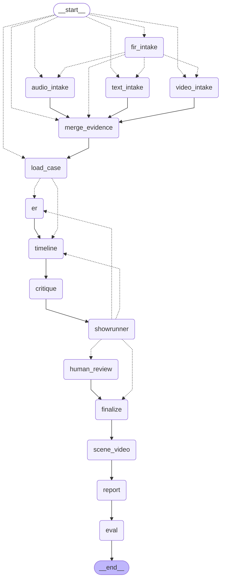

# ForenSynth pipeline graph

Generated by `python pipeline/graph.py --diagram docs/pipeline_graph.md` from `pipeline/graph.py`. Dashed edges are conditional (chosen by a router); solid edges always run.

